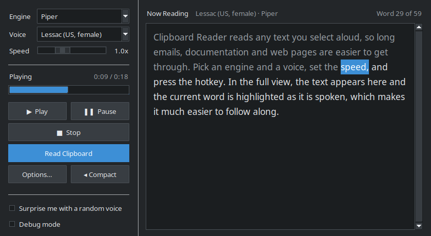
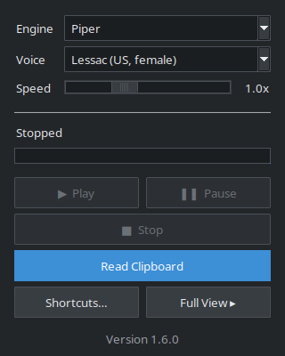
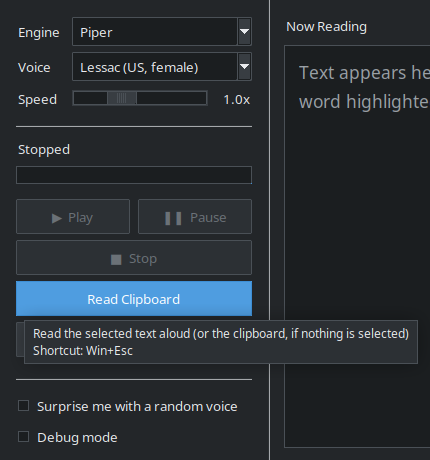
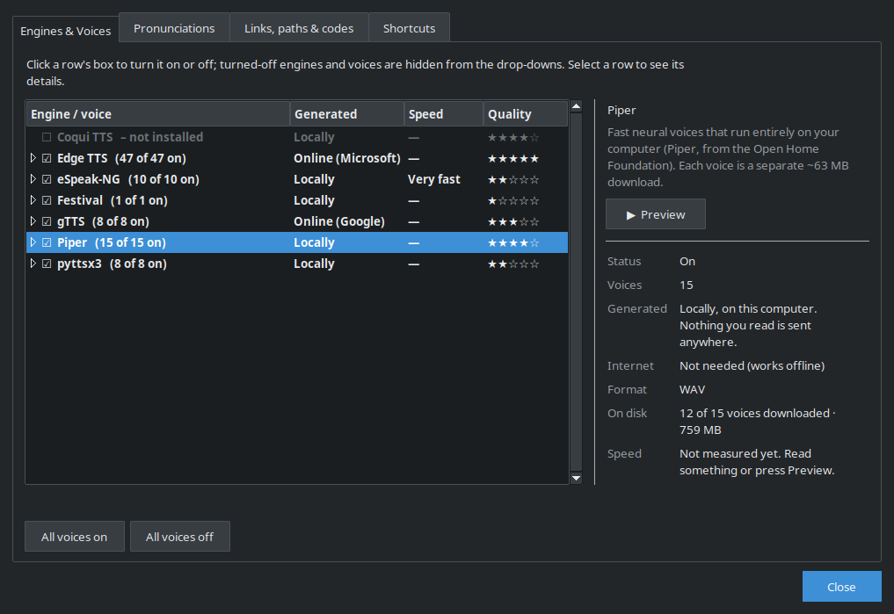
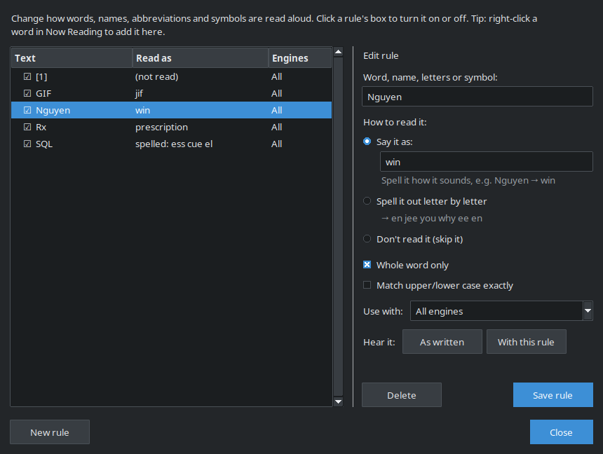
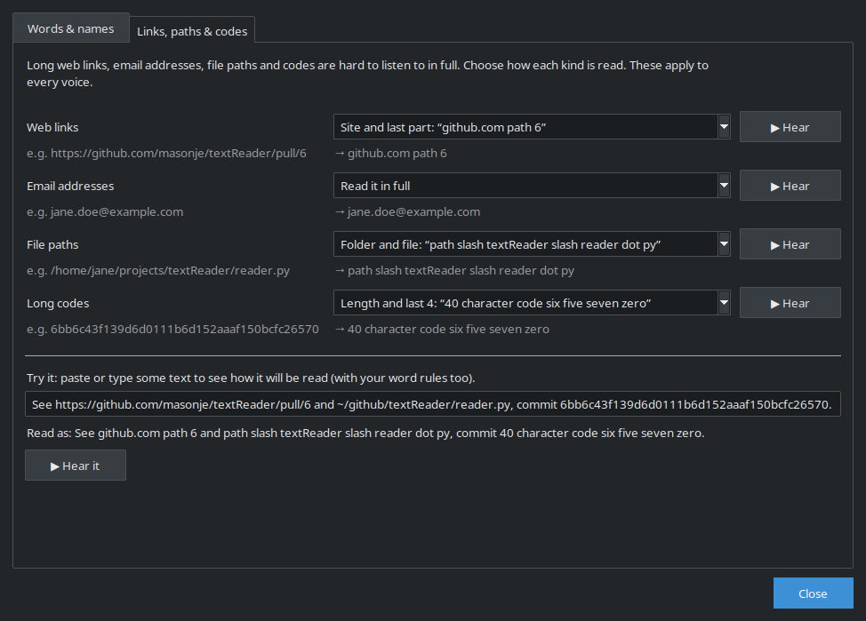

# Clipboard Reader
Reads text aloud. A Python take on TextAloud MP3, made for Linux and tested on Ubuntu. It should also run on other Linux systems, macOS and Windows; see [Tested Platforms](#tested-platforms).

**Version:** 1.11.0 — see [Changelog](#changelog) for what changed in each version.



## Why I Built This
I love Linux, but I've struggled with dyslexia my whole life. Having text read aloud is how I get through long emails, documentation and web pages. On Windows I used TextAloud MP3, and on the Mac I used the built-in speech features, but on Linux I couldn't find anything that did what I needed.

So I made my own. Copilot helped me get it started, and Claude helped me turn it into the tool I actually need. Clipboard Reader is what lets me live in Linux on both my work and home machines.

## Screenshots

**Compact view**: just the controls, small enough to leave on screen. (The **Full view**, shown at the top, adds the text being read with the current word highlighted, plus options.)



**Hover hints**: rest the mouse on Read Clipboard, Play, Pause or Stop to see what it does and its keyboard shortcut.



**Options** (the **Options…** button) has four tabs:

**Engines & Voices**: turn engines and voices on or off, preview them, download or delete voices, and see where audio is generated, speed and quality.



**Pronunciations**: change how words, names, abbreviations and symbols are read.



**Links, paths & codes**: read long web links, email addresses, file paths and codes in a short form instead of spelling them out.



## Features
- **Pronunciations:** change how words, names, abbreviations and symbols are read aloud (Options… → Pronunciations, or right-click a word in Now Reading). See [Pronunciations](#pronunciations).
- **Links, paths & codes:** long web links, email addresses, file paths and codes (hashes, keys, account numbers) are read in a short form you choose, like "github.com path 6" or "40 character code six five seven zero". See [Links, paths and codes](#links-paths-and-codes).
- **Surprise me:** tick "Surprise me with a random voice" (Full view, bottom left) and each read uses a random voice from the engines and voices you have turned on. Voices that would need a download first are skipped, and the same voice isn't picked twice in a row. The Now Reading header shows which voice was used. If the picked voice fails (for example, an online service doesn't answer), another engine is tried automatically.
- Two views: **Compact** (just the controls, small enough to leave on screen) and **Full** (adds a panel showing the text being read, with the current word highlighted). Switch with the Full View ▸ / ◂ Compact button.
- Reads clipboard text aloud
- Adjustable playback speed (0.5x–2x), which can be changed while reading without restarting it
- System tray icon
- GUI controls
- Configurable keyboard shortcuts (Options… → Shortcuts). Hover over Read Clipboard, Play, Pause or Stop to see its shortcut.
- One **Options…** window with tabs for Engines & Voices, Pronunciations, Links, paths & codes, and Shortcuts

## Requirements

- Linux, macOS or Windows (see [Tested Platforms](#tested-platforms))
- Python 3.10+, with the packages listed in [pyproject.toml](pyproject.toml). `scripts/setup.sh` installs them.
	- coqui-tts is optional (for Coqui TTS). It isn't installed by default because it needs PyTorch; the app can install it for you, see [Speech Engines](#speech-engines).
- libmpv: plays the audio and lets the speed change while reading. Without it the app falls back to pygame, and a speed change applies from the next read.
- ffmpeg: word-highlight timing, and speed control when libmpv is missing.
- espeak-ng (for the eSpeak-NG engine) and festival + text2wave (for the Festival engine), both optional.

`scripts/setup.sh` installs all of these on Ubuntu/Debian. On other systems (untested, see below):

| | libmpv | ffmpeg |
|---|---|---|
| Fedora | `sudo dnf install mpv-libs` | `sudo dnf install ffmpeg` |
| Arch | `sudo pacman -S mpv` | `sudo pacman -S ffmpeg` |
| macOS (Homebrew) | `brew install mpv` | `brew install ffmpeg` |
| Windows | `libmpv-2.dll` (for example from the mpv-player-windows "dev" builds), next to the app or on your PATH | from [ffmpeg.org](https://ffmpeg.org/download.html), with its `bin` folder on your PATH |

### Tested Platforms

| Platform | Status |
|---|---|
| Ubuntu 26.04 | ✅ Tested. Used every day, and every release is checked on it. |
| Debian and other Ubuntu-based systems | Should work. `scripts/setup.sh` uses `apt`, the same as Ubuntu. |
| Fedora, Arch | ⚠️ Not tested. The packages above should work, but `scripts/setup.sh` only supports `apt`, so install the system packages yourself, then create `.venv` and run `.venv/bin/pip install -e ".[dev]"`. |
| macOS | ⚠️ Not tested. Should work with the Homebrew packages above. Global shortcuts need the terminal (or the app) to be allowed under Privacy & Security → Accessibility. |
| Windows | ⚠️ Not tested with the current version (mpv playback). Should work with the steps above. There's no setup script for Windows yet. |

If you try it on an untested platform, please open an issue saying whether it worked.

## Installation

On Ubuntu/Debian:

```bash
scripts/setup.sh
```

This installs the system packages, creates the `.venv` virtual environment with the app and its Python packages, and adds a desktop launcher. Run the app with:

```bash
.venv/bin/textreader
```

To install a standalone copy instead, run `scripts/install.sh`. It builds a single-file `reader` program, copies it to `~/.local/bin/reader`, and adds a "Screen Reader" launcher to the app menu. The target system still needs libmpv and ffmpeg.

## Using It

Select or copy some text and press the read shortcut (**Win+Esc** by default), or click **Read Clipboard**. Use **Play**, **Pause** and **Stop** to control it, and the **Speed** slider (0.5x–2x) to change speed, even while it's reading. **Engine** and **Voice** are locked while audio is being built or played; press Stop to change them.

### Keyboard Shortcuts
- **Win+Escape** — Read selected text
- **Win+Shift+R** — Resume/Play
- **Win+Shift+P** — Pause
- **Win+Shift+S** — Stop

Change them in **Options… → Shortcuts**. Resting the mouse on the Read Clipboard, Play, Pause or Stop button shows its current shortcut.

### Checking the Version
- The Compact view shows the version at the bottom of the window.
- From a terminal: `reader --version` (or `.venv/bin/textreader --version` from source).

## Speech Engines

Pick the engine and voice in the control window. Each engine remembers its own voice choice.

The **Engines & Voices** tab of **Options…** shows a list of every engine and voice showing where its speech is **Generated**, its **Speed**, and its **Quality**:
- **Generated:** "Locally" means the speech is made on your computer and nothing you read leaves it (Piper, Coqui, eSpeak-NG, Festival, pyttsx3). "Online (Google)" for gTTS and "Online (Microsoft)" for Edge TTS mean the text you read is sent to that company's servers, which return the audio. Piper downloads each voice once but then runs offline.
- **Details:** select an engine or voice to see its details: gender, accent, whether it needs the internet, download size, audio format, the model or service behind it, and for Edge voices Microsoft's personality and "good for" tags.
- **Speed** is measured, not guessed. Every read (and every Preview) records how long the voice took to build compared with how long the speech is. "About 8 s to build 1 minute of speech" means fast. Builds that include a one-time download or model load are skipped.
- **Quality** starts at a typical rating for the engine. Click the stars to rate a voice yourself, or **reset** to go back to the default.
- **▶ Preview** speaks a short sample with the selected voice. If the voice isn't downloaded yet, a Downloading Voice window shows the progress (with Cancel) and then plays the sample.
- **Downloaded voices** (Piper) show their size on disk and have a **Download** button with a progress bar and Cancel, or a **Delete download** button that frees the space (the voice downloads again next time it's used). Selecting the engine shows how many voices are downloaded and the total size. Downloads keep going if you close the window.
- **On/off:** click a row's ☑ box to turn it on or off. Turned-off ones disappear from the Engine and Voice drop-downs. **All voices on** and **All voices off** act on the selected engine. At least one engine, and one voice per engine, always stays on.

These are saved in settings.json as `disabled_engines`, `disabled_voices`, `voice_stats` and `voice_ratings`.

| Engine | Voices | Quality | Needs |
|---|---|---|---|
| [Piper](textreader/engines/engine_piper.py) | 15 English voices (US, UK, Scottish; male and female) | Natural neural voices, offline | Each voice is ~63 MB, downloaded the first time it's used (or from Options… → Engines & Voices) to `~/.textReader/voices/piper`; downloaded voices can be deleted there |
| [Edge TTS](textreader/engines/engine_edge.py) | ~47 English voices from Microsoft (US, UK, Australia, Canada, India, Ireland, and more) | Very natural neural voices | Internet connection |
| [gTTS](textreader/engines/engine_gtts.py) | 8 English accents (US, UK, Australia, Canada, India, Ireland, South Africa, Nigeria) | Good | Internet connection |
| [pyttsx3](textreader/engines/engine_pyttsx3.py) | The system's speech voices (eSpeak on Linux, SAPI on Windows, NSSpeech on macOS) | Robotic on Linux | — |
| [eSpeak-NG](textreader/engines/engine_espeak.py) | English accents, plus female variants of US and UK English | Robotic | `espeak-ng` |
| [Festival](textreader/engines/engine_festival.py) | Installed Festival voices (e.g. `festvox-kallpc16k`) | Robotic | `festival` |
| [Coqui TTS](textreader/engines/engine_coqui.py) | One voice (Tacotron2) | Neural, slow on CPU | Installed on request, about 1 GB (see below) |

**Installing Coqui TTS:** pick Coqui TTS as the engine and the app offers to install it. It creates a private Python environment in `~/.textReader/engines/coqui` and installs CPU-only PyTorch and Coqui there (about 1 GB, several minutes). It shows the progress, and you can cancel. Coqui then runs in a background worker process that keeps the model loaded between reads. To remove it, delete `~/.textReader/engines`. If you run from source and have `coqui-tts` installed in the app's own environment, that is used instead.

Run `reader --check-engines` (or `.venv/bin/textreader --check-engines` from source) to see which engines work and try each one.

## Pronunciations
Open the **Pronunciations** tab of **Options…**, or right-click a word (or a selection) in Now Reading and choose **Change how "word" is read…**. Each rule matches a word, name, letters or symbol and does one of:

| Option | Example |
|---|---|
| **Say it as** — type how it sounds | Nguyen → "win", GIF → "jif", Rx → "prescription" |
| **Spell it out** letter by letter | SQL → "ess cue el" |
| **Don't read it** | footnote markers like `[1]` |

Options per rule: **Whole word only** (on by default, so "cat" doesn't change "concatenate"; symbols such as `&` or `[1]` still match next to a word), **Match upper/lower case exactly**, and **Use with** all engines or just one. Click a rule's box to turn it on or off. **Hear it: As written / With this rule** plays the word with your current voice so you can compare before saving.

Rules apply to every read (including Surprise me). Now Reading still shows your original text, and word highlighting is timed to what is actually said. With Debug mode on, the terminal shows the text sent to the voice. Rules are applied in one pass, longest first, and are saved as `pronunciations` in settings.json; the logic lives in [pronunciation.py](textreader/pronunciation.py).

### Links, paths and codes
The **Links, paths & codes** tab of **Options…** chooses how long, hard-to-listen-to text is read. Each row shows an example, what it will sound like, and a **▶ Hear** button. The **Try it** box shows how any text you paste will be read (word rules included) and can play it.

| Kind | Options (first is the default) |
|---|---|
| **Web links** | Site and last part: "github.com path 6" · Site and "weblink": "github.com weblink" · Just say "link" · Read it in full |
| **Email addresses** | Read it in full · Just the name before the @: "jane doe" · Email to the name: "email to jane doe" · Just say "email address" |
| **File paths** | Folder and file: "path slash textReader slash reader dot py" · File path: "file path slash textReader slash reader.py" · Say the file name: "path to reader.py" · Just say "file path" · In full, saying slashes: "file path home slash jane slash … slash reader.py" · In full, no slashes: "file path home jane … reader.py" |
| **Long codes** | Length and last 4: "40 character code six five seven zero" (or "16 digit code …" for numbers) · Say the first 4: "code six bee bee six" · Just say "code" · Read it in full |

What counts:
- **Web links** start with `http://`, `https://`, `ftp://` or `www.`. Punctuation that ends a sentence isn't part of the link, and the query (`?…`) is ignored.
- **File paths** start with `/` and have at least two parts, or start with `~/`, `./`, `../` or a drive letter like `C:\`. So "and/or" and "1/2" are left alone.
- **Long codes** are 12 or more letters and digits run together with at least 2 digits, optionally joined by `-` or `_`: git hashes, UUIDs, tracking numbers, licence keys, card and account numbers. Dates and phone numbers aren't long enough to count.

Links, paths and codes are handled before word rules. The choices are saved as `text_filters` in settings.json.

## Word Highlighting (Full view)
None of the TTS engines report when each word is spoken, so [word_timing.py](textreader/word_timing.py) estimates it:
1. Each word is weighted by length, with extra time after punctuation where voices pause.
2. ffmpeg's `silencedetect` finds where speech starts and ends and the pauses in between.
3. Pauses are matched to the punctuation they belong to, which keeps long text from drifting.

In testing with gTTS, sentence starts landed within about 0.1 s of the real audio. Within a sentence, the highlight is an estimate and can run slightly ahead of or behind the voice.

## Settings
Settings are saved in `~/.textReader/settings.json`. The **Shortcuts** tab of the **Options…** window has drop-downs for the modifier and key of each action; click **Save** to use them. The same values can also be edited directly in JSON:

```json
{
	"debug_mode": false,
	"playback_speed": 1.0,
	"tts_engine": "gTTS",
	"theme": "auto",
	"view_mode": "compact",
	"full_window_size": "",
	"surprise_voice": false,
	"pronunciations": [
		{"text": "SQL", "mode": "spell", "say": "", "whole_word": true, "match_case": false, "engine": "", "enabled": true},
		{"text": "Nguyen", "mode": "say", "say": "win", "whole_word": true, "match_case": false, "engine": "", "enabled": true}
	],
	"text_filters": {"urls": "site_end", "emails": "full", "paths": "tail", "codes": "length"},
	"hotkeys": {
		"read_selected_text": "Win+Esc",
		"play": "Win+Shift+R",
		"pause": "Win+Shift+P",
		"stop": "Win+Shift+S"
	}
}
```

`theme` can be `"auto"` (follow the desktop's light/dark setting), `"dark"`, or `"light"`.
`view_mode` is `"compact"` or `"full"`, and `full_window_size` remembers the Full view's size (for example `"840x460"`). Both are saved automatically.

## Troubleshooting

**Start it from a terminal** to see what it's doing: `reader` (or `.venv/bin/textreader` from source). It prints what it reads, what it plays, and any errors.

**Command-line options:**

| Option | What it does |
|---|---|
| `--version` | Print the version and exit. |
| `--check-engines` | Speak a short phrase with every engine and report which work and why the others don't. The quickest check after installing or updating. |

**Debug mode:** tick **Debug mode** at the bottom of the Full view (saved as `debug_mode`). The terminal then also shows each engine's dependency check, the exact text sent to the voice after filters and pronunciation rules, and word-timing details.

**Messages to look for:**

| Message | Meaning |
|---|---|
| `🔊 Playback: mpv` | Normal. Speed can change while reading. |
| `🔊 Playback: pygame (speed changes apply to the next read)` | libmpv wasn't found. Install it (see [Requirements](#requirements)). |
| `⚠️ mpv: …` | mpv reported a playback error. |
| `⚠️ No text to read` | The read shortcut found nothing selected and an empty clipboard (a short beep plays). |

**Playback problems:** start it with an mpv log, reproduce the problem, and include the log in your report:

```bash
TR_MPV_LOG=/tmp/mpv.log reader
```

**Reset settings:** quit the app and rename `~/.textReader/settings.json`. It starts with the defaults and makes a new one. Downloaded Piper voices (`~/.textReader/voices`) and the Coqui install (`~/.textReader/engines`) are kept.

**An engine is missing from the list:** it may be turned off in **Options… → Engines & Voices**, or missing something it needs. `--check-engines` says which.

## Contributing

How the code is laid out, running the tests, adding a speech engine, building, and debugging tools are in [CONTRIBUTING.md](CONTRIBUTING.md).

## Changelog

The version number is stored in `__version__` in [textreader/__init__.py](textreader/__init__.py).

### 1.11.0 — 2026-11-14
- **Changed:** Playback now uses mpv. The audio plays as soon as it's built, at any speed: before, every read at a speed other than 1.0x was first run through ffmpeg (and MP3 compressed again), with nothing playing until that finished.
- **Added:** The speed can be changed while reading. The slider stays on during playback, and the voice keeps its pitch. The time shown follows the speed.
- **Changed:** Engine and Voice are greyed out while audio is being built, played or paused, and come back after Stop or when the read ends.
- **Changed:** Without libmpv the app falls back to pygame as before (speed changes apply from the next read), and the sped-up copy is now WAV, so MP3 isn't compressed twice.
- **Fixed:** The app could freeze when reading if the program that owns the clipboard didn't answer. It now gives up after 2 seconds and says so in the terminal.
- **Added:** `TR_MPV_LOG=/path/file.log` writes mpv's full log for troubleshooting playback.
- **Docs:** The README is now for people using the app, with new Troubleshooting and Tested Platforms sections. Project layout, tests, adding an engine, building and debugging moved to [CONTRIBUTING.md](CONTRIBUTING.md).
- **Install:** New requirements: `python-mpv` (in `pyproject.toml`) and libmpv (`libmpv2`, added to `scripts/setup.sh`).

### 1.10.0 — 2026-11-14
- **Added:** Hover hints on the Read Clipboard, Play, Pause and Stop buttons show what each does and its keyboard shortcut. They follow changes made in Options → Shortcuts. The Options… button has a hint too.

### 1.9.0 — 2026-11-14
- **Changed:** The code is now one Python package, `textreader/`. The 3,000-line `reader.py` is split into `app.py`, `options.py` (the Options window), `theme.py` and `hotkeys.py`, and `tts_engines/` is now `textreader/engines/`. See [Project Layout](CONTRIBUTING.md#project-layout).
- **Changed:** `setup.sh`, `build.sh` and `install.sh` moved to `scripts/`. Dependencies moved from `requirements.txt` to `pyproject.toml`, and `scripts/setup.sh` installs the app into `.venv`.
- **Changed:** Run from source with `.venv/bin/textreader` (or `python -m textreader`). `run.sh` is gone.
- **Added:** `tests/` with pytest tests for the pronunciation rules, the links/paths/codes filters, word timing and shortcuts. Run them with `.venv/bin/python -m pytest`.
- **Fixed:** When a voice Preview failed, showing the error crashed, so the reason never appeared.

### 1.8.1 — 2026-11-14
- **Changed:** Version bump after the 1.8.0 Options window release was merged; no feature changes.

### 1.8.0 — 2026-11-13
- **Changed:** Engines & Voices, Pronunciations, Links, paths & codes, and Shortcuts are now tabs in one **Options** window, opened by a single **Options…** button next to Full View. The separate Engines & Voices…, Pronunciations… and Shortcuts… buttons are gone.
- **Changed:** The Shortcuts tab saves without closing the window ("Shortcuts saved."), and Reset is now "Reset to defaults".
- **Changed:** Right-clicking a word in Now Reading opens Options on the Pronunciations tab with that word filled in.

### 1.7.0 — 2026-11-13
- **Added:** Links, paths & codes tab in the Pronunciations window. Long web links, email addresses, file paths and codes are read in a short form you choose (e.g. "github.com path 6", "path slash textReader slash reader dot py", "40 character code six five seven zero"), with an example and Hear button for each, and a Try it box. Saved as `text_filters`.
- **Changed:** The Pronunciations window has two tabs: Words & names, and Links, paths & codes. "New rule" moved next to Delete and Save.
- **Changed:** Skipped words no longer leave stray spaces before punctuation.

### 1.6.0 — 2026-11-13
- **Added:** Pronunciation editor (Full view → Pronunciations…). Rules can say a word differently, spell it out letter by letter, or skip it, with whole-word, match-case and per-engine options, an on/off box per rule, and "Hear it" buttons to compare before and after. Saved as `pronunciations`.
- **Added:** Right-click a word or selection in Now Reading to add or edit its pronunciation.
- **Changed:** Word highlighting timing uses the words actually spoken after pronunciation rules.
- **Changed:** Text boxes and radio buttons follow the light/dark theme.

### 1.5.0 — 2026-11-13
- **Added:** "Surprise me with a random voice" checkbox (Full view options, above Debug). Each read picks a random voice from the engines and voices that are on and ready (no downloads), avoiding an immediate repeat. Saved as `surprise_voice`.
- **Added:** The Now Reading header shows the voice and engine used for the current read.
- **Added:** If a surprise voice fails, the app tries a voice from a different engine (up to two more) and says so in the dialog.
- **Changed:** Debug is now a checkbox instead of an ON/OFF drop-down.
- **Fixed:** gTTS could fail with "Engine produced no audio" when Google sent back an empty reply (usually while it's limiting requests). gTTS now retries once, then explains what happened. Error messages stay up for 8 seconds instead of 2.
- **Fixed:** Play replays the last read even when it used a different engine than the one selected.

### 1.4.0 — 2026-11-13
- **Added:** Download progress for voices. When a read needs a voice that isn't downloaded yet, the Building dialog shows "Downloading voice: 21.3 of 63 MB (34%)" with a progress bar before it builds.
- **Added:** In Engines & Voices, Piper voices have a **Download** button with progress and Cancel, and a **Delete download** button (with confirmation). Each voice shows its size on disk, and the engine shows the total downloaded.
- **Added:** Preview of a voice that isn't downloaded opens a Downloading Voice window with progress and Cancel, then builds and plays the sample.
- **Changed:** In the voice details panel, Preview, Download/Delete and the rating now sit at the top so they're never cut off by long detail lists.
- **Fixed:** Cancelling a Piper download no longer leaves the voice's config file behind.
- **Engines:** new optional `voice_download_info()`, `download_voice(progress=…)` and `delete_voice()` for engines with downloadable voices.

### 1.3.0 — 2026-11-13
- **Added:** Voice choice. A Voice drop-down under Engine lists each engine's voices, and the choice is remembered per engine (`"voices"` in settings.json).
- **Added:** Piper engine: natural, offline neural voices (15 English voices). Each downloads on first use.
- **Added:** Edge TTS engine: Microsoft's online neural voices (about 47 English voices).
- **Added:** gTTS accents (US, UK, Australia, Canada, India, Ireland, South Africa, Nigeria); female and regional eSpeak voices; the system voices for pyttsx3; and installed Festival voices.
- **Added:** An Engines & Voices manager (Full view, bottom left) to turn engines and individual voices on or off, so the drop-downs only show the ones you use.
- **Added:** A "Generated" column and field showing whether each engine and voice makes speech on this computer or through an online service (gTTS: Google, Edge TTS: Microsoft), including that the text being read is sent to that service. Engines name their service with a new `service` attribute.
- **Added:** Voice details in the manager: each engine and voice shows what it is (gender, accent, online/offline, download size, audio format, model or service, and Edge's personality and "good for" tags), its measured speed, and a star quality rating you can change, plus a Preview button. Engines can provide this through new optional `about`, `quality`, `needs_internet`, `describe_voice()` and `voice_ready()`.
- **Added:** `--check-engines` reports which engines work and tests each one.
- **Fixed:** pyttsx3 wasn't installed and failed with "Engine produced no audio" on multi-line text, because its eSpeak driver could return before it finished writing the file.
- **Fixed:** The speed setting only worked with gTTS. It now applies to every engine.
- **Added:** The app can install Coqui TTS for you. Choosing it offers a one-click install into a private environment (CPU-only PyTorch, about 1 GB) with a live log and Cancel. Coqui then runs in a background worker, so it also works in the packaged app. Engines can offer this through new optional `can_install()` and `install()` methods.
- **Fixed:** After switching to an engine with missing dependencies, the status still said "Stopped" and the buttons came back on, because the startup code kept a separate copy of the "missing dependencies" flag.
- **Changed:** Drop-down lists grow wider than their box so long voice names aren't cut off.

### 1.2.0 — 2026-11-12
- **Added:** Compact and Full views. Compact is the existing control window. Full adds a resizable "Now Reading" panel that shows the text being read aloud, highlights the current word, dims words already read, scrolls to follow along, and shows "Word N of M". The view and the Full window size are remembered.
- **Added:** `word_timing.py` estimates word timings from the text and the pauses in the audio.
- **Added:** A play timer (elapsed / total, e.g. `0:08 / 1:47`) at the top right of the progress bar.
- **Changed:** The window title is just "Clipboard Reader". The version shows only at the bottom of the Compact view.
- **Changed:** Settings such as Debug moved to an options area at the bottom of the Full view's left column, where future options will go too. It's hidden in the Compact view, which keeps Compact smaller.
- **Fixed:** Reading could be impossible to stop. Stop stayed greyed out until audio actually started, which can take 20 seconds or more for long text. Stop pressed while audio was being slowed down (speeds below 1.0x) was ignored, and reading started anyway. Stop is now available, and the status shows "Building audio…" or "Preparing audio…", for the whole time. Stop always wins over audio that's still being prepared.
- **Fixed:** Shortcuts using Ctrl never fired, because with Ctrl held X reports a control character instead of the letter.
- **Fixed:** An error inside a hotkey handler could stop the keyboard listener and silently disable every hotkey until restart. Handlers now catch errors, and a watchdog restarts the listener if it ever stops.
- **Fixed:** Pressing Play while paused restarted from the beginning instead of resuming, because pygame reports "not busy" while paused. Resuming also kept the time spent paused, which threw off the progress bar.

### 1.1.0 — 2026-11-12
- **Added:** The version is shown in the control window's title bar and footer, and `--version` prints it.
- **Added:** Light and dark themes. The app follows the desktop's light/dark setting (GNOME `color-scheme`, macOS, or Windows), or you can set `"theme"` in settings.json. The control window, Shortcut Preferences, the build dialog, drop-down lists, and message boxes all use the same colors.
- **Changed:** Cleaner control window layout with aligned Engine/Debug/Speed rows, full-width buttons, and Read Clipboard as the main action. The "Building MP3" dialog is now "Building Audio", since most engines produce WAV.
- **Fixed:** `install.sh` and `build.sh` failed with "Text file busy" when the app was running. They now copy to a temporary file and rename it into place.
- **Fixed:** Cancel in the "Building MP3" dialog sometimes did nothing, or let the audio keep building and then play.
	- The dialog is now always created and updated on the Tk main thread. Hotkey reads are handed to it instead of opening the dialog from the keyboard-listener thread.
	- Cancel, the window's close button, and Esc close the dialog immediately.
	- Builds really stop: Festival and eSpeak-NG processes are killed, and gTTS stops between text chunks. pyttsx3 and Coqui can't be interrupted, so their output is thrown away.
	- Audio is built into a temporary file and only replaces the playback file if the build wasn't cancelled. Leftover temporary files are removed at startup.
	- The Stop hotkey/button cancels a build in progress, and starting a new read cancels the previous build.
- **Changed:** `TTSEngine.synthesize()` takes an optional `cancel_event`. Added the `run_cancellable()` helper and the `SynthesisCancelled` exception in `tts_engines/base.py`.
- **Changed:** eSpeak-NG reads its text from stdin, so text starting with `-` isn't treated as an option.

### 1.0.0 — 2026-08-27
First versioned baseline, covering everything up to this point:
- Clipboard and selected-text reading with play, pause, stop, and adjustable speed (0.5x–2x).
- Pluggable TTS engines in `tts_engines/`: gTTS, pyttsx3, eSpeak-NG, Festival, and Coqui TTS.
- Configurable keyboard shortcuts with a preferences dialog, saved to `~/.textReader/settings.json`.
- System tray icon and control window.
- Ubuntu 26.04 support.
- `build.sh` and `install.sh` for a PyInstaller build with an app-menu launcher and icon.
